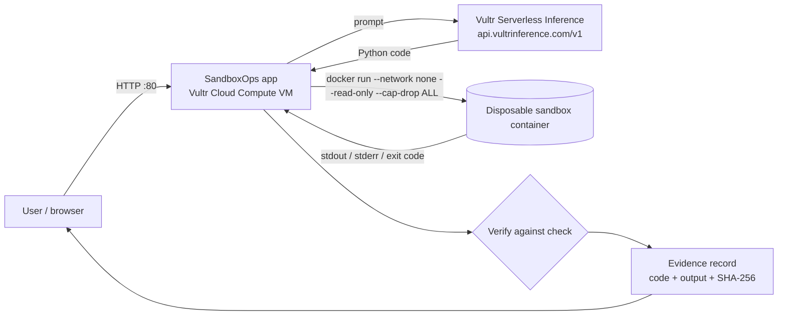

# SandboxOps — Blast Radius Zero for AI agents

An agent that writes code is only useful if you can prove what ran and that it could not do damage.
SandboxOps turns every agent task into **plan → sandbox → verify → evidence**, running on Vultr.

Built for the lablab.ai **Vultr Agent Rush** hackathon (Challenge 1: Blast Radius Zero). MIT licensed.

## How Vultr is used
| Piece | Where it runs |
|---|---|
| Web app + API (`app.py`, port 80, `/health`) | **Vultr Cloud Compute VM** (Ubuntu), systemd service |
| Sandbox for every agent action (`SANDBOX=docker`) | Throwaway Docker containers **on the same Vultr VM**: `--network none`, read-only rootfs, non-root, all capabilities dropped, CPU/memory/pids caps, auto-removed |
| Planner (natural language → Python) | **Vultr Serverless Inference**, OpenAI-compatible API at `https://api.vultrinference.com/v1` (`VULTR_INFERENCE_API_KEY`, model via `VULTR_INFERENCE_MODEL`) |

No Vultr GPUs are used. Without an inference key the app still runs the built-in demo tasks (offline planner).

## Architecture


## The containment moment
Click `network_attempt`: agent-written code tries to open a socket to the internet. The sandbox refuses
(`network disabled in sandbox` locally; no network interface at all in Docker) and the UI shows a red **CONTAINED** banner.
`fork_bomb_ish` (infinite loop) is killed by the CPU limit/timeout. `bill` computes a patient bill and is **verified** at `$551.00`.

## Quickstart
```bash
# local (process sandbox: rlimits, stripped env, socket blocked, timeout)
cd sandboxops && python3 app.py            # http://localhost:8080  (PORT to change)
# on a fresh Vultr Ubuntu VM, as root (port 80)
git clone https://github.com/igoreduardoai/sandboxops && cd sandboxops
VULTR_INFERENCE_API_KEY=... bash deploy/vultr-deploy.sh
curl http://<VM_IP>/health
```
API: `GET /health`, `GET /api/tasks`, `POST /api/run {"task":"bill"}` or `{"prompt":"..."}`.

## Tests
```bash
python3 test_agent.py   # 3/3: bill verified, network blocked, infinite loop killed
python3 test_app.py     # 5/5: /health, verified run, two containment runs, UI served
```

## Honest limitations
- The local backend blocks network at the Python socket level (best effort); real isolation is the Docker backend.
- The Docker backend and the deploy script are meant for the Vultr VM; check the live URL for the current status.
- Free-form prompts are executed and contained but not auto-verified (no ground-truth check); only the demo tasks have checks.
- Containers share the VM kernel; gVisor or per-task VMs would be the next hardening step.

## Roadmap
gVisor runtime · per-tenant audit log export · policy file (allowed packages, egress allowlist) · signed evidence.

## Author
Igor Eduardo (A.S.) — Antler Founder Residency (F26, Austin); 15 years of entrepreneurship.
