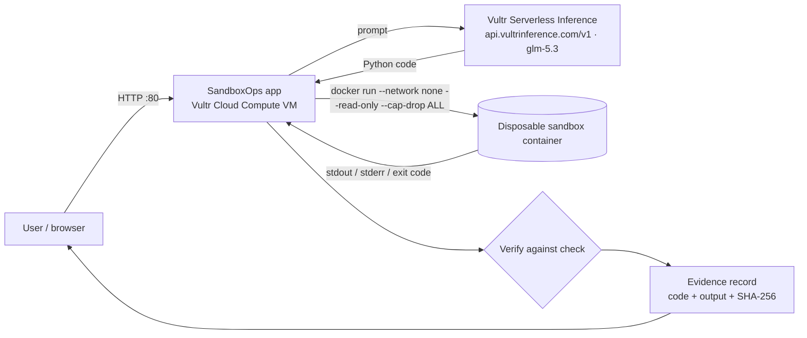

# SandboxOps — Blast Radius Zero for AI agents

An agent that writes code is only useful if you can prove what ran and that it could not do damage.
SandboxOps turns every agent task into **plan → sandbox → verify → evidence**, running on Vultr.

Built for the lablab.ai **Vultr Agent Rush** hackathon (Challenge 1: Blast Radius Zero). MIT licensed.

**Live demo (Vultr Cloud Compute, Chicago):** http://64.177.13.126/  
`/health` → `{"status":"ok","backend":"docker","planner":"vultr-inference"}`

## How Vultr is used
| Piece | Where it runs |
|---|---|
| Web app + API (`app.py`, port 80, `/health`) | **Vultr Cloud Compute VM** (Ubuntu 24.04, 2 GB, Chicago), systemd `sandboxops` |
| Sandbox for every agent action (`SANDBOX=docker`) | Throwaway Docker containers **on the same Vultr VM**: `--network none`, read-only rootfs, non-root, all capabilities dropped, CPU/memory/pids caps, auto-removed |
| Planner (natural language → Python) | **Vultr Serverless Inference**, OpenAI-compatible API at `https://api.vultrinference.com/v1` (model **`glm-5.3`**) |

No Vultr GPUs are used. Without an inference key the app still runs the built-in demo tasks (offline planner).

## Live results (2026-11-05, America/Chicago)
| Task | Result |
|---|---|
| `bill` | **VERIFIED** `$551.00` (Docker backend) |
| free-form prompt `sum of first 50 primes` | planner `vultr-inference:glm-5.3` → stdout **`5117`** (correct) |
| `network_attempt` | **CONTAINED** — socket blocked / no network in sandbox |
| `fork_bomb_ish` | **CONTAINED** — killed by sandbox timeout/CPU limit |

## Architecture


## The containment moment
Click `network_attempt`: agent-written code tries to open a socket to the internet. The sandbox refuses
(`network disabled in sandbox` via in-process block; Docker also has `--network none`) and the UI shows a red **CONTAINED** banner.
`fork_bomb_ish` (infinite loop) is killed by the CPU limit/timeout. `bill` computes a patient bill and is **verified** at `$551.00`.

## Quickstart
```bash
# local (process sandbox: rlimits, stripped env, socket blocked, timeout)
cd sandboxops && python3 app.py            # http://localhost:8080  (PORT to change)
# on a fresh Vultr Ubuntu VM, as root (port 80)
git clone https://github.com/igoreduardoai/sandboxops && cd sandboxops
VULTR_INFERENCE_API_KEY=... bash deploy/vultr-deploy.sh
curl http://<VM_IP>/health
```
API: `GET /health`, `GET /api/tasks`, `POST /api/run {"task":"bill"}` or `{"prompt":"..."}`.

## Tests
```bash
python3 test_agent.py   # 3/3: bill verified, network blocked, infinite loop killed
python3 test_app.py     # 5/5: /health, verified run, two containment runs, UI served
```

## Challenges
### Local vs production isolation
The default laptop path uses a **process sandbox**: rlimits, stripped environment, a Python-level socket block that raises `PermissionError('network disabled in sandbox')`, and a hard timeout. That is enough to demo containment in the UI, but it is not kernel isolation. Production on Vultr sets `SANDBOX=docker` so every agent action runs in a throwaway container on the same Cloud Compute VM (`--network none`, read-only rootfs, non-root, all capabilities dropped, CPU/memory/pids caps, auto-removed). Getting Docker + systemd + port 80 working on a fresh Ubuntu 24.04 VM (user `sandboxops` in the `docker` group, unit `sandboxops`, `deploy/vultr-deploy.sh`) was the main deployment challenge; the public IP is an ephemeral hackathon VM on credits.

### Planner vs product
Vultr Serverless Inference (`glm-5.3` via `api.vultrinference.com/v1`) plans free-form prompts into short Python. It is OpenAI-compatible and therefore swappable. The product claim is not “unique model,” it is **blast-radius-zero execution on Vultr Cloud Compute**. Without an inference key the app still runs the built-in demo tasks through the offline planner.

### Evaluation honesty
Only the built-in demo tasks carry verification checks (`bill` verifies at `$551.00`). Free-form prompts are executed and contained but **not** auto-verified. The automated suite is small by design: `test_agent.py` 3/3 (bill verified, network blocked, infinite loop killed) and `test_app.py` 5/5 (`/health`, verified run, two containment runs, UI served). Live checks on 2026-11-05 (America/Chicago) also covered bill, primes→5117, network CONTAINED, loop CONTAINED, with `/health` reporting `backend=docker` and `planner=vultr-inference`.

### Kernel shared with the host
Docker containers on the VM still share the host kernel. That is an honest residual risk for a Blast Radius Zero pitch; stronger isolation (gVisor or per-task VMs) is listed as next work, not as done.

## Honest limitations
- The local backend blocks network at the Python socket level (best effort); real isolation is the Docker backend on the Vultr VM.
- Free-form prompts are executed and contained but not auto-verified (no ground-truth check); only the demo tasks have checks.
- Containers share the VM kernel; gVisor or per-task VMs would be the next hardening step.
- The public demo IP is a temporary hackathon VM (credits); treat it as ephemeral.

## What's next
1. **Larger frozen eval** — grow beyond the 4 live demos / 3+5 automated checks to a ≥10–20 task containment+verify suite with a frozen answer key, and declare `n` in the README (and form if space remains).
2. **gVisor (or equivalent) runtime** on the Vultr VM so sandbox processes do not share the host kernel with the app.
3. **Policy file** — allowlisted packages and optional egress allowlist for tasks that must call out safely.
4. **Per-tenant audit export** — ship evidence records (code, stdout/stderr, exit code, per-run SHA-256 from `app.py`) as an export auditors can keep.
5. **Signed evidence** — optional signature over the evidence payload so a third party can verify the hash chain.
6. Keep Inference as “planner on Vultr”; keep **Cloud Compute + Docker** as the flagship story in every pitch.


## Author
Igor Eduardo (A.S.) — Antler Founder Residency (F26, Austin); 15 years of entrepreneurship.
